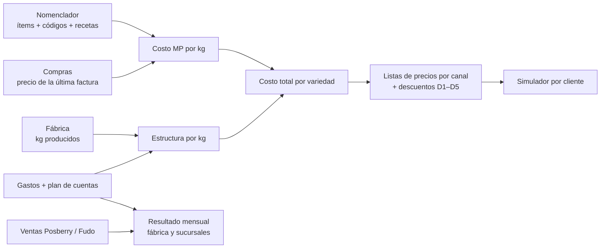

# Nomenclador

Catálogo único de todo lo que maneja YA! Chipacitos: materia prima, insumos, semielaborados, productos, presentaciones de venta y combos. Cada ítem tiene un código interno, sus códigos de Posberry y Fudo y, si corresponde, su receta.

Estado: **definición de alcance** (2026-10-29). Objetivo: **lunes 09-11** tener el MVP presentado a Marcos y definido el camino con Posberry.

## Fuentes

Las planillas originales están en `docs/nomenclador/fuentes/`, **solo en la máquina local**. Están en `.gitignore` porque el repo es público y tienen recetas, márgenes, precios, sueldos y retiros. Este documento describe su estructura sin copiar los números.

| Archivo | Quién lo pasó | Qué tiene |
|---|---|---|
| `nomenclador-marcos-2026-10.xlsx` | Marcos | Tres listas sueltas, sin cruce entre ellas: Posberry mayorista (~68 códigos), Fudo (~120 IDs) y "Materia prima e insumos pedidos" (~66 nombres sin código) |
| `costeo-y-precios-v2.1.xlsx` | Nico (consultor de administración) | Insumos con presentación y precio, recetas por variedad, estructura por kg, costo total, listas de precios por canal, descuentos y simulador |
| `resultado-mensual-v1.16.xlsx` | Nico | Resultado económico mensual de la fábrica y de cada sucursal, registro de gastos con plan de cuentas, ventas por canal y pendientes |

## Decisiones tomadas (2026-10-29)

| Tema | Decisión |
|---|---|
| Rol | El nomenclador pasa a ser la **fuente única**. En el MVP se arma **sin conectar** los catálogos actuales. La migración de los módulos se hace después del OK de Marcos. |
| Tipos | Materia prima, insumo (packaging, limpieza), semielaborado, producto terminado, presentación de venta, combo/promo y concepto sin stock (logística, envío, diferencia kg). Se refinan con Marcos y Ceci. |
| Código interno | Sí. Opción elegida: prefijo por tipo + número (`MP-0001`, `IN-0001`, `SE-0001`, `PT-0001`). Opción a consultar con Marcos: código legible (`CLA-CONG-500`). |
| Variantes | Producto base + sabor + presentación. |
| Recetas | Cantidades, merma y rendimiento **opcionales**. Se completan con Marcos cuando vea la primera vista. |
| Costeo | Más adelante. |
| Unidades | Se reusan las unidades y conversiones del Bloque 2 (A2b). |
| Códigos externos | Un ítem puede tener varios códigos de Posberry y Fudo. Los "(-10% DESCUENTO)" y "P YA" de Fudo van al mismo ítem que el normal. Los códigos sin mapear generan un aviso. |
| Precios | El MVP no lleva precios. Listas de precios y descuentos son el objetivo siguiente. |
| Fudo | Venta minorista de los locales. Se guardan sus códigos, pero no se toca la integración. |
| Quién edita | Solo admin y perfiles similares. |
| Entrega | Todo en un MVP, desde `qa`. |
| Excel de Marcos | Lo depuro yo y Marcos y Ceci lo revisan en la app. |

## Qué se aprende de cada planilla

### Nomenclador de Marcos

- **Posberry** mezcla cosas distintas:
  - `(INS.)`: bolsas y cajas
  - `(SUC.)`: lo que la fábrica manda a las sucursales (masa por kg, congelados por sabor, fiambre x 100 gr)
  - presentaciones mayoristas y de SuperMAX (1/2, 2, 5 y 10 kg)
  - packaging
  - conceptos (LOGÍSTICA, DIFERENCIA KG)
  - ítems de prueba
- **Fudo** es venta al público: horneados por peso y por unidad, congelados, cafés, smoothies, chipandwich, XXL, combos y promos.
- **A depurar**: duplicados (dulce de leche x 10 kg con dos códigos), ítems de prueba ("PRODUCTO DE PRUEBA", "chipacitos") y conceptos que no son productos.

### Costeo y Precios (Nico)

- **Insumos**: cada uno tiene presentación de compra, precio actual, precio anterior y variación. Hay insumos base (harina, sardo, barra, leche, huevo, margarina, sal) e insumos que definen cada sabor (roquefort, choclo, salame, cheddar, jamón).
- **Recetas**: son por **lote**, con un coeficiente por insumo (fracción de la presentación de compra) y un **rendimiento** en kg de chipá terminado.
  - Hay receta completa de Clásicos, Salame, Jamón, Maíz, Cheddar y Roquefort.
  - Anís es Clásicos más la esencia.
  - **Falta la de Xtra Cheese**, que tiene que pasar Ricardo.
  - Ya se pueden convertir a cantidades reales (kg, unidades, ml). Eso **destraba en parte A3** del Bloque 2.
- **Cada variedad es una receta completa**, no "masa base + topping". Por ejemplo, Clásicos lleva sardo y barra, y Jamón lleva barra y jamón pero no sardo. El modelo tiene que soportar los dos casos.
- **Estructura**: gastos de estructura del mes ÷ kg producidos. Es una cuota por kg igual para todas las variedades.
- **Listas de precios por canal**:
  - Transferencia a Sucursales
  - Distribuidor B2B
  - Mayorista General
  - Consumidor Final

  Cada una tiene un margen objetivo. Hay un semáforo de actualización con umbral y redondeo, IVA e Ingresos Brutos.
- **Descuentos D1–D5**:
  - D1 y D2 por volumen semanal (no se suman entre sí)
  - D3 por pago contado
  - D4 por retiro en fábrica
  - D5 para cadenas (es un tope)

  Hay un tope acumulado y la regla de no aplicarlos sobre la lista Distribuidor.
- **Simulador**: cliente + variedad + canal + kg/semana + forma de pago + retiro → precio final y semáforo de margen.

### Resultado Mensual (Nico)

- **Posberry factura las ventas de la fábrica.** De ahí salen las facturas A/B, las notas de crédito y los presupuestos sin factura (PSP) para sucursales propias, Supermax, mayoristas y distribuidores, y consumidor final.
- **Fudo** es la fuente de las ventas de los locales. Todavía no se cruza.
- Tiene un plan de cuentas de gastos parecido al de la app (`plan_cuentas`, Bloque 1).
- Toma los kg producidos por mes de las planillas de producción de Ricardo. La app ya los registra en Fábrica.
- **El precio de transferencia a sucursales cambia semana a semana.** Nico recomienda fijarlo una vez por mes.

## Integración con Posberry

- Es de Software Studio (Argentina; WhatsApp +54 9 11 3704-7000). **No tiene API pública documentada.**
- Se integra con Tiendanube, Mercado Pago, Fiserv y balanzas, así que por dentro tiene algún mecanismo de sincronización.
- El plan multi-sucursal incluye productos y precios centralizados, cuentas corrientes y envío de mercadería entre sucursales.
- Hoy los datos entran a la app por un Google Sheet (`app/api/sync-sheets`), con un mapeo por nombre (`producto_mapeos`). Ese circuito hace mucho que no se alimenta.
- **Quién lo encara**: Marcos y Mati (consultor) van a preguntar si conviene seguir con Posberry o desarrollar en la app la gestión de pedidos, precios y listas.
- Opciones, en orden de preferencia:
  1. API o usuario integrador pedidos a Software Studio
  2. Exportaciones automáticas
  3. Importar el reporte mapeando **por código** de Posberry
  4. Automatizar el panel web (frágil, no recomendado)
- Dirección:
  - (a) traer ventas y facturación
  - (b) mandar a Posberry los pedidos de mayoristas y sucursales, que hoy se recargan a mano

## Hacia dónde va (el reporte de Ricardo)

Las dos planillas de Nico son el destino: que Ricardo maneje precios, márgenes y descuentos con datos reales. La app ya tiene casi todas las piezas sueltas:

Orden propuesto:
1. **MVP del nomenclador** (09-11)
2. Recetas con cantidades
3. Costeo automático
4. Listas de precios, descuentos y simulador
5. Resultado mensual

## Preguntas abiertas

- [ ] La tercera lista del Excel de Marcos ("Materia prima e insumos pedidos"): ¿es lo que compra la fábrica o lo que piden los locales?
- [ ] Combos de Fudo: ¿hace falta su composición? Default: tipo combo con composición opcional, sin descontar stock.
- [ ] Consumo de los locales (café, leche, vasos): fuera del MVP. ¿Entra más adelante?
- [ ] Código interno: prefijo + número vs legible. Consultar con Marcos.
- [ ] Recetas de Costeo: la cantidad de leche por lote parece muy baja (¿leche en polvo o error?), sal de Clásicos (Nico pide confirmar con Ceci), receta de Xtra Cheese.
- [ ] Los pedidos que se recargan en Posberry, ¿son para facturar o solo para registro y control? (Resultado Mensual sugiere que se facturan.)
- [ ] Locales propios vs franquicias: ¿cuáles son cuáles? Define si el envío es venta o traslado.
- [ ] Nombres a unificar: Roquefort = Queso Azul, Xtra Cheese = Extra Cheese. Verdeo aparece solo en Fudo (XXL).
